# Anleitung Turniermanager

Alle Funktionen im Überblick, in der Reihenfolge eines Turniertages. Die App läuft im Browser
(am besten Chrome oder Edge) und speichert alles auf dem Gerät.

## Inhalt

1. [Kurzfassung](#kurzfassung)
2. [Vorbereitung](#1-vorbereitung)
3. [Spielbetrieb](#2-spielbetrieb)
4. [Timer und Signaltöne](#3-timer-und-signaltöne)
5. [Übersicht aller Spiele](#4-übersicht-aller-spiele)
6. [Rangliste, Spieler, Verlauf, Statistik](#5-rangliste-spieler-verlauf-statistik)
7. [Beamer](#6-beamer)
8. [Musik und Spotify](#7-musik-und-spotify)
9. [Turnier beenden und Siegerehrung](#8-turnier-beenden-und-siegerehrung)
10. [Export, Import, Neues Turnier](#9-export-import-neues-turnier)
11. [Offline nutzen](#10-offline-nutzen)
12. [Tastenkürzel](#tastenkürzel)
13. [Fragen und Antworten](#fragen-und-antworten)

## Kurzfassung

1. Spielform, Felder und Spielzeit einstellen, Namen eintragen, **Turnier starten**.
2. **Beamer** öffnen und auf den Beamer-Bildschirm schieben.
3. **Runde x starten**, Spieler gehen auf die Felder, **Leertaste** startet den Timer.
4. Nach dem Spiel auf das Gewinnerteam tippen (oder Punkte eintragen).
5. Wiederholen, am Ende **Turnier beenden** für die Siegerehrung.

`Strg+Z` macht jede Änderung rückgängig.

## 1. Vorbereitung

Vor dem Start gibt es die Seite **Turnier einrichten**.

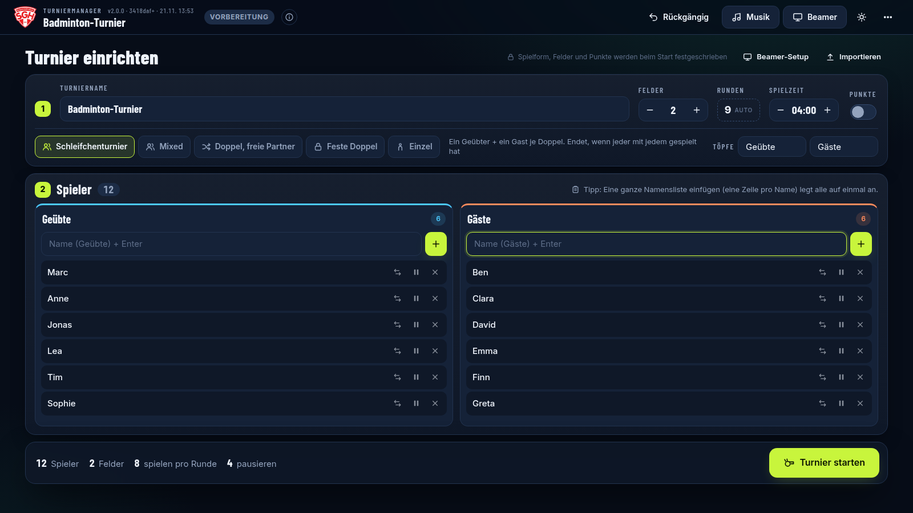

### Grunddaten

| Feld | Bedeutung |
|---|---|
| **Turniername** | Erscheint in der Kopfzeile und auf dem Beamer. |
| **Felder** | Anzahl der Spielfelder. Pro Runde gibt es höchstens so viele Spiele. |
| **Runden** | Geplante Rundenzahl. Beim Schleifchenturnier ergibt sie sich automatisch (siehe unten). |
| **Spielzeit** | Länge einer Runde im Timer, in 30-Sekunden-Schritten. |
| **Punkte** | An: Ergebnisse werden als Punkte eingetragen (z. B. 21 : 15), die Punktdifferenz zählt in der Rangliste. Aus: nur Sieg/Niederlage. |

### Spielform

| Spielform | Ablauf |
|---|---|
| **Schleifchenturnier** | Ein Geübter und ein Gast bilden ein Doppel. Das Turnier **endet automatisch**, sobald jeder Geübte mit jedem Gast zusammen gespielt hat. Der komplette Spielplan wird vorab berechnet. |
| **Mixed** | Jedes Doppel besteht aus einer Dame und einem Herrn. |
| **Doppel, freie Partner** | Ein gemeinsamer Topf, die Partner wechseln jede Runde. |
| **Feste Doppel** | Die Teams bleiben das ganze Turnier zusammen. |
| **Einzel** | Eins gegen eins. |

Bei Schleifchen und Mixed gibt es zwei **Töpfe**. Die Namen der Töpfe lassen sich ändern
(zum Beispiel „Geübte“ / „Gäste“).

### Spieler eintragen

- Namen eintippen und mit **Enter** bestätigen. Mit zwei Töpfen gibt es je Topf ein Eingabefeld.
- Mehrere Namen auf einmal: eine Namensliste einfügen (eine Zeile pro Name).
- Namen antippen zum **Umbenennen**.
- Pfeile ändern die **Reihenfolge**, bei festen Doppeln bestimmt sie die Teams.
- Mit dem Wechsel-Symbol wandert ein Spieler in den **anderen Topf**.
- Mit dem Pausen-Symbol nimmt ein Spieler nicht teil. Mit dem Kreuz wird er entfernt.

### Beamer-Setup

Mit **Beamer-Setup** wählst du das Wartebild, das der Beamer zeigt, solange das Turnier noch
nicht läuft (siehe [Beamer](#6-beamer)).

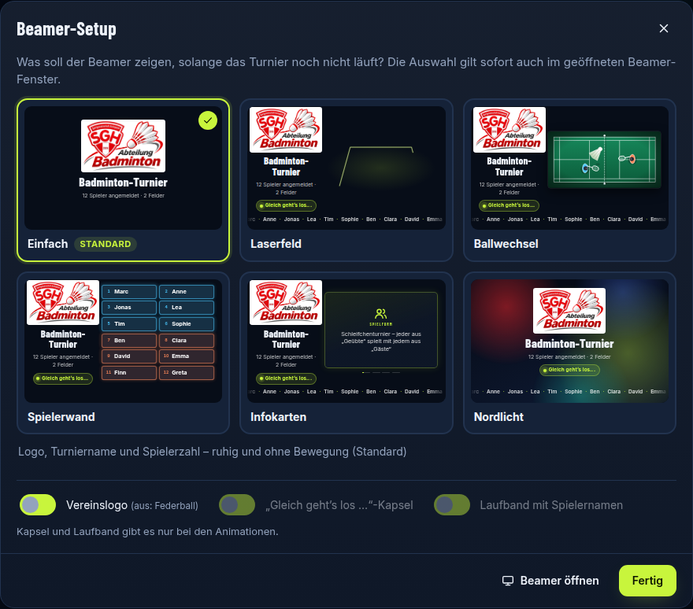

### Start

**Turnier starten** legt das Format fest und lost Runde 1 aus. Danach sind Spielform und
Grundeinstellungen gesperrt. Neue Spieler lassen sich weiterhin nachmelden.

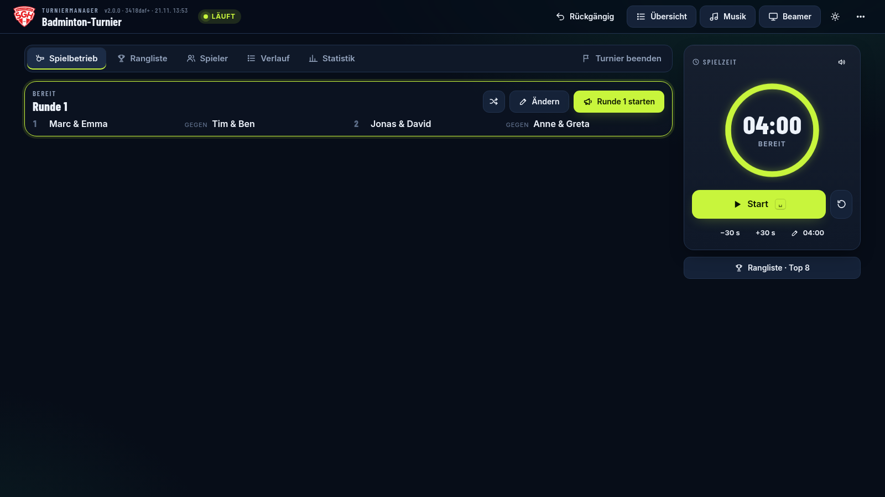

## 2. Spielbetrieb

Der Reiter **Spielbetrieb** ist der Hauptbildschirm während des Turniers. Bei üblichen
Bildschirmen (ab 1600 × 900) passt er mit zwei Feldern ohne Scrollen auf eine Seite, bei kleineren
Bildschirmen oder vielen Feldern wird kontrolliert gescrollt. Rechts bleibt der Timer sichtbar.
Auf dem Handy steht der Timer oben und der Rangliste-Knopf ganz unten.

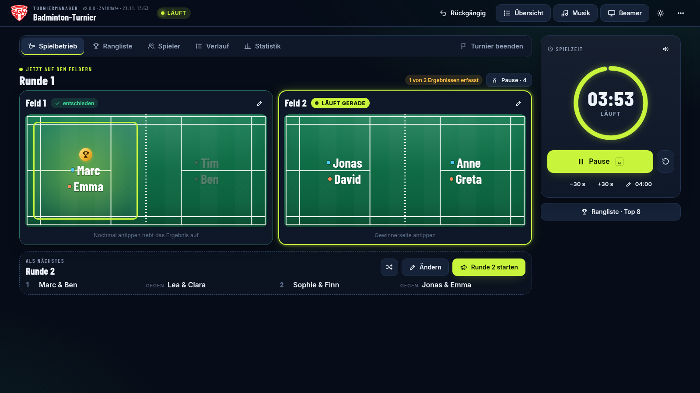

- **Jetzt auf den Feldern:** Die laufende Runde steht groß im Vordergrund, daneben der Stand der
  Ergebnisse („1 von 2 Ergebnissen erfasst“). Ein oder zwei Felder stehen nebeneinander, drei bis
  vier in zwei Spalten, mehr in drei bis vier Spalten. Die Größe richtet sich nach der
  Bildschirmhöhe, auf dem Handy stehen die Felder untereinander. Ein Spiel ohne Ergebnis zeigt
  „läuft gerade“.
- **Ergebnis eintragen:** Auf das Gewinnerteam tippen. Der Verlierer wird grau, beim Gewinner
  erscheint ein kleiner goldener Pokal. Nochmal tippen hebt das Ergebnis auf. Mit eingeschalteten
  Punkten trägst du die Punkte beider Teams ein, der Sieger ergibt sich daraus.
- **Als Nächstes:** Unter den Feldern steht in einer schmalen Zeile die nächste Runde mit den
  Paarungen. Dort sitzen die wichtigsten Knöpfe:
  - **Runde x starten** ruft die Runde auf die Felder. Sind alle Ergebnisse eingetragen, ist der
    Knopf hervorgehoben. Fehlen noch Ergebnisse oder läuft der Timer noch, fragt die App vorher
    nach. Fehlende Ergebnisse lassen sich später nachtragen.
  - **Neu auslosen** (Würfel-Symbol) würfelt neu. Beim Schleifchenturnier werden alle noch nicht
    gestarteten Runden neu gelost.
  - **Ändern** öffnet die nächste Runde mit Spielfeldern:

    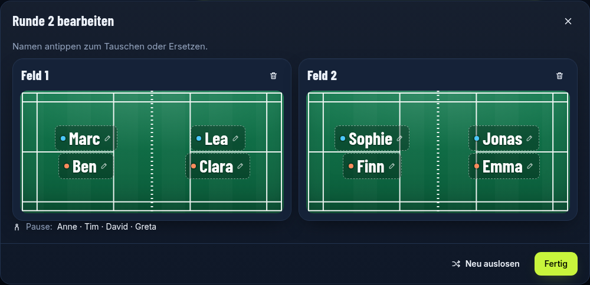

    Namen antippen zum **Tauschen oder Ersetzen**, Papierkorb entfernt ein Spiel, **+ Match** fügt
    ein zusätzliches Spiel aus pausierenden Spielern hinzu (wenn ein Feld frei ist), **Neu auslosen**
    ist auch hier. Von Hand geänderte Runden sind als „von Hand angepasst“ markiert und werden
    nicht mehr automatisch überschrieben. Die Pausierenden dieser Runde stehen unten.
- **Weitere Angaben auf Knopfdruck:**
  - **Pause · n** zeigt, wer in der laufenden Runde aussetzt.
  - **Bereits gespielt** öffnet die früheren Runden. Team antippen ändert den Sieger, Punkte lassen
    sich direkt korrigieren. Der Gewinner ist am Pokal und an der grünen Schrift zu erkennen.

    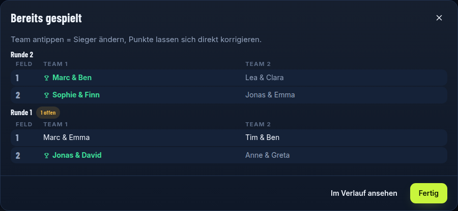

  - **Rangliste · Top 8** (unter dem Timer) zeigt die besten acht, **Ganze Rangliste** wechselt in
    den Reiter Rangliste.

    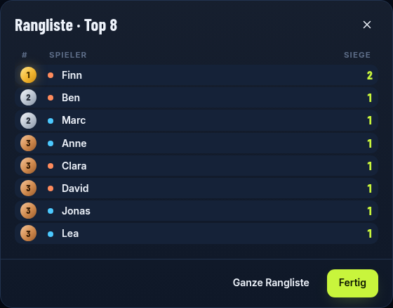

  - Die übernächste Runde und alle anderen Runden stehen in der **Übersicht**.

### Wie ausgelost wird

- Wer weniger Spiele hat, spielt zuerst.
- Unter Gleichrangigen gewinnt die Aufteilung mit den wenigsten Wiederholungen: derselbe Partner
  zählt stark, derselbe Gegner weniger, zweimal hintereinander spielen ebenfalls.
- Nachzügler bekommen einen Ausgleich und müssen keine Spiele am Stück nachholen.

### Schleifchenturnier: festes Ende

Der Spielplan steht von Anfang an fest: Jede Partnerschaft Geübter + Gast kommt genau einmal
vor. Die Rundenzahl ergibt sich aus Spielerzahl und Feldern. Sind alle Paarungen gespielt und die
Ergebnisse der letzten Runde eingetragen, endet das Turnier von selbst und die Siegerehrung
beginnt. Bei ungerader Gesamtzahl kann eine Partnerschaft übrig bleiben. Wer mehr Runden
spielen will, nutzt **Weiterspielen**.

## 3. Timer und Signaltöne

Der Timer steht im Spielbetrieb und läuft auch auf dem Beamer.

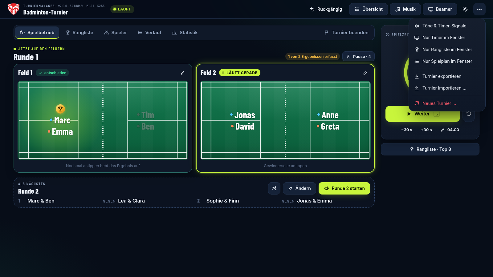

- **Leertaste** startet und pausiert, **Zurücksetzen** stellt die Zeit zurück.
- Die Zeit lässt sich über die Zeitanzeige ändern (Minuten, Sekunden, **Übernehmen**).
- Beim Start läuft eine Abfolge: Die Musik wird leiser, dann ertönt der Startton, danach läuft
  die Zeit. Während des Vorlaufs steht „Gleich …“ auf dem Timer. Ein weiterer Druck bricht den
  Start ab.
- Signale gibt es zum **Start**, zur **Halbzeit** und zum **Ende**.

**Töne & Timer-Signale** (Menü oben rechts, oder das Lautsprecher-Symbol am Timer):

- Gesamtlautstärke der Signale.
- Pro Signal: **Eingebaut**, **Eigene Datei** (MP3 o. ä.) oder **Aus**, dazu **Testen**.
- Das Endsignal kann einige Sekunden **vor Ablauf** abgespielt werden.

Eigene Dateien bleiben im Browser gespeichert, auf jedem Gerät einmal einrichten.

### Sprachansage

Im selben Fenster gibt es die **Sprachansage**: Beim Start einer Runde sagt die App an, wer auf
welchem Feld spielt („Runde 3. Feld 1: Anne und Finn gegen Jonas und David. Feld 2: …“, auf Wunsch
mit „Pause haben …“). Die Stimme „Thorsten“ kommt mit der App und ist **unabhängig vom Browser**.

1. Einmal mit Internet **Sprachpaket laden** (ca. 93 MB). Es bleibt danach im Browser gespeichert.
2. **Runden ansagen** einschalten, bei Bedarf **Pause mit ansagen**. **Testen** spielt eine
   Beispielansage.
3. Beim Start einer Runde wird die Ansage gesprochen, die Musik wird währenddessen leiser. Mit dem
   Lautsprecher-Knopf neben der Rundenüberschrift lässt sich die Ansage **nochmal** abspielen.
4. **Entfernen** löscht das Paket wieder aus dem Browser.

Die nächste Runde wird im Hintergrund schon vorbereitet, damit die Ansage ohne Wartezeit kommt. Die
Sprachansage läuft ohne Internet, braucht aber auf älteren Geräten etwas Rechenleistung und Speicher.
Das Paket gibt es nur, wenn der Server es bereitstellt (siehe README, „Sprachpaket“). Auf jedem Gerät
und in jedem Browser muss es einmal geladen werden.

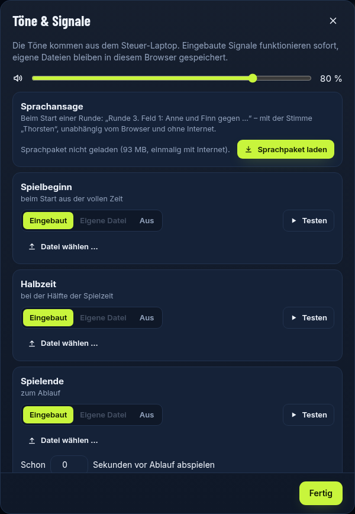

## 4. Übersicht aller Spiele

Der Knopf **Übersicht** (neben Musik und Beamer) zeigt alle Runden auf einmal: kommende Runden
zuerst, darunter die gespielten.

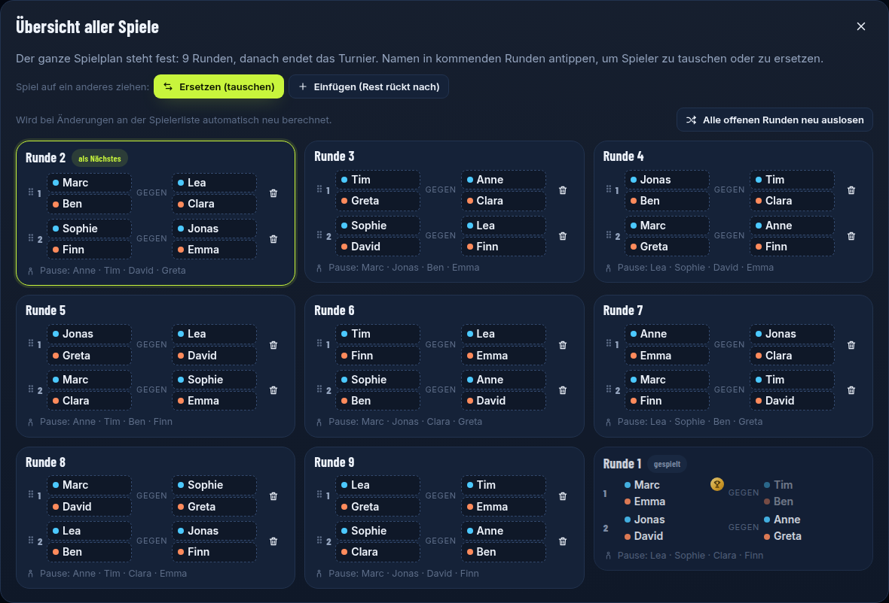

- **Kommende Runden ändern:** Namen antippen zum Tauschen/Ersetzen, Papierkorb entfernt ein
  Spiel.
- **Spiele neu sortieren per Drag & Drop:** Ein Spiel an der Zeile greifen und auf ein anderes
  ziehen. Oben wählst du den Modus:
  - **Ersetzen (tauschen):** Beide Spiele tauschen die Plätze.
  - **Einfügen (Rest rückt nach):** Das Spiel wird an der Zielposition eingefügt, alle anderen
    rutschen nach hinten.
  - Das geht über Rundengrenzen hinweg. Die Anzahl der Spiele pro Runde und die Feldnummern der
    Plätze bleiben gleich.
- **Doppelte Spieler:** Steht ein Spieler in einer Runde zweimal, warnt die Runde in Rot. Für die
  nächste Runde sperrt das „Runde x starten“, bis es behoben ist.
- **Alle offenen Runden neu auslosen:** Verwirft alle Handänderungen und rechnet neu.
- Gespielte Runden sind nur zum Ansehen. Ergebnisse änderst du im Spielbetrieb oder im Verlauf.

## 5. Rangliste, Spieler, Verlauf, Statistik

### Rangliste

Reihenfolge: meiste Siege, dann weniger Spiele, mit Punkten dann die Punktdifferenz. Gleichstand
teilt sich einen Platz, danach folgt der nächste (1, 1, 2, 3). Die ersten drei haben Medaillen.
Bei zwei Töpfen lässt sich zwischen **Alle** und den einzelnen Töpfen umschalten.

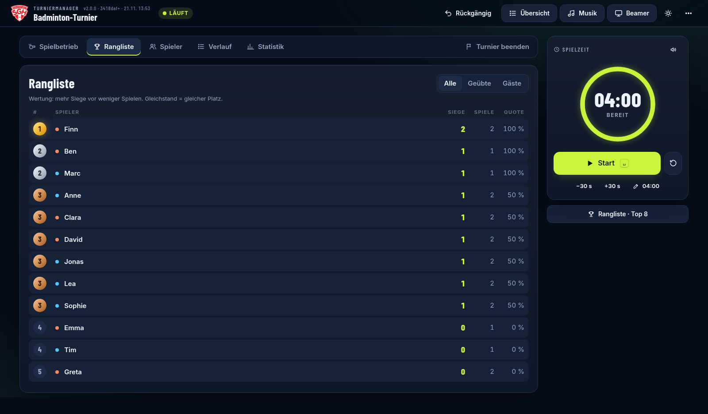

### Spieler

- **Nachmelden:** Name eintragen (und Topf wählen), der Nachzügler wird fair eingereiht.
- Umbenennen, Topf wechseln, pausieren (z. B. bei Verletzung) oder löschen.
- Pausierende Spieler werden bei der Auslosung übersprungen. Steht ein Pausierender noch in der
  nächsten Runde, warnt die App.

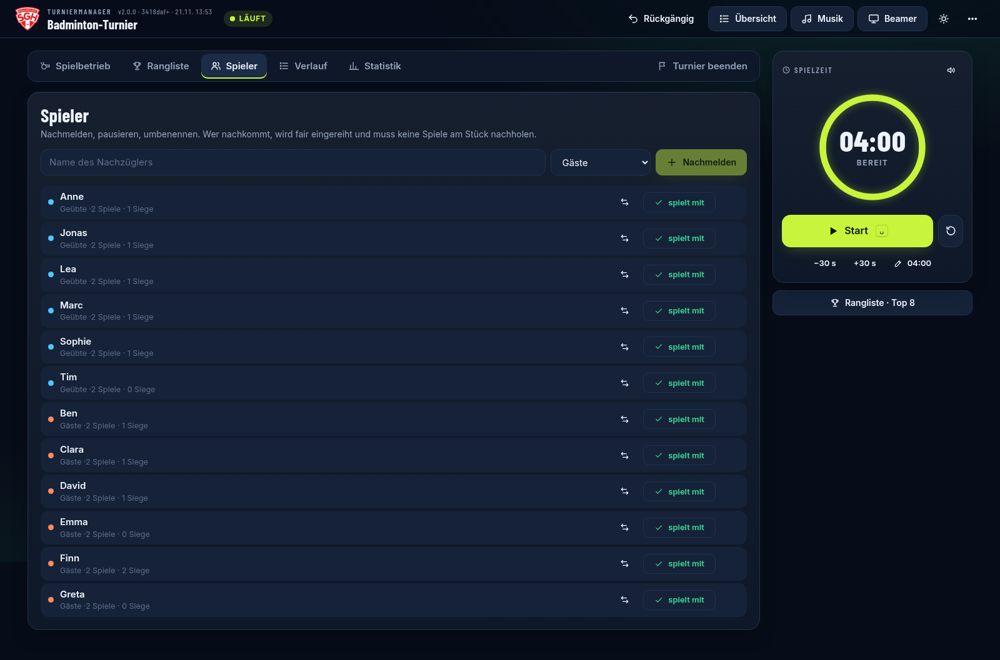

### Verlauf

Alle gespielten Runden mit Teams, Punkten und Siegern. Das **Suchfeld** zeigt nur die Runden
eines Spielers. Sieger und Punkte sind hier nachträglich änderbar.

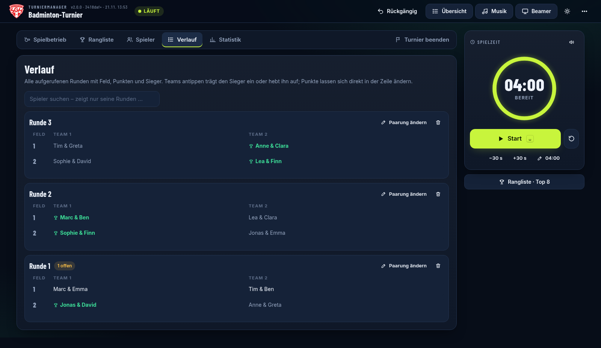

### Statistik

Runden, Matches mit Ergebnis, aktive Spieler, Spiele pro Spieler und Minuten seit Start. Dazu
eine Liste der Spiele je Spieler und **wiederholte Partnerschaften**.

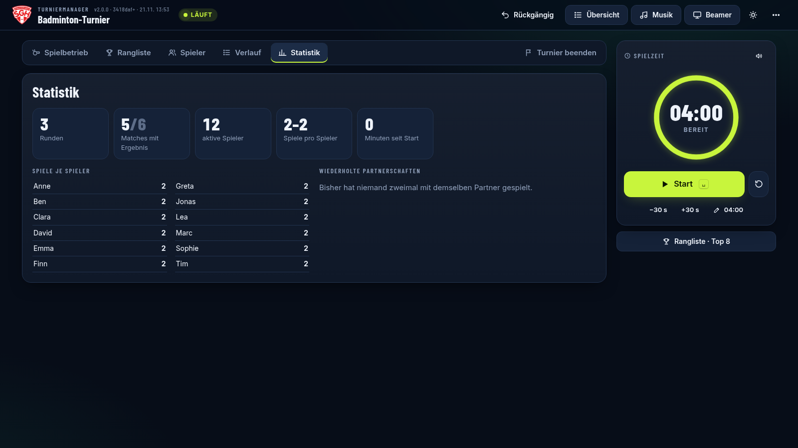

## 6. Beamer

Der **Beamer**-Knopf (oder Taste `B`) öffnet die Großanzeige in einem neuen Fenster. Fenster auf
den Beamer-Bildschirm ziehen, dort `F` für Vollbild. Die Anzeige aktualisiert sich live, auch ohne
Internet. Die Menüeinträge **Nur Timer / Nur Rangliste / Nur Spielplan im Fenster** öffnen direkt
eine feste Ansicht.

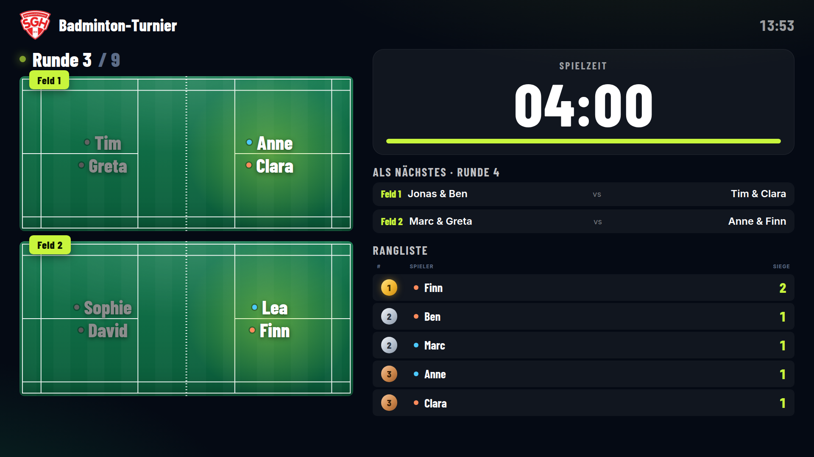

| Taste | Ansicht |
|---|---|
| `1` | **Übersicht:** automatisch, Felder, Timer und Rangliste zusammen |
| `2` | **Felder:** große Spielfeldbilder mit den Namen |
| `3` | **Timer** in groß |
| `4` | **Rangliste** |
| `F` | Vollbild an/aus |

| Felder (`2`) | Timer (`3`) | Rangliste (`4`) |
|---|---|---|
| 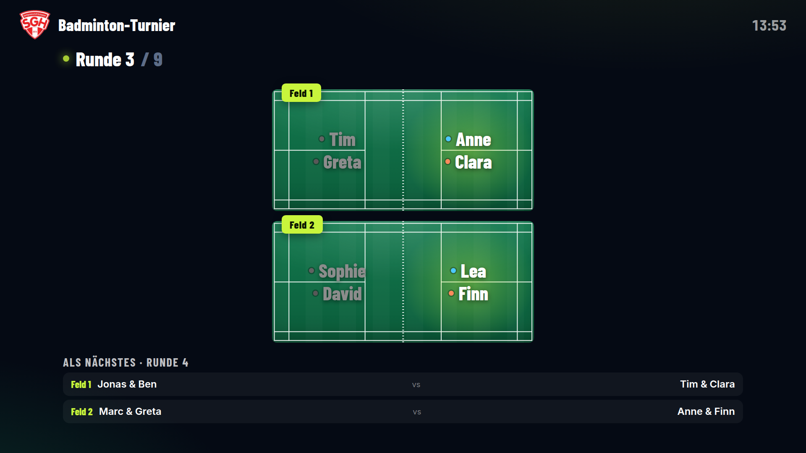 | 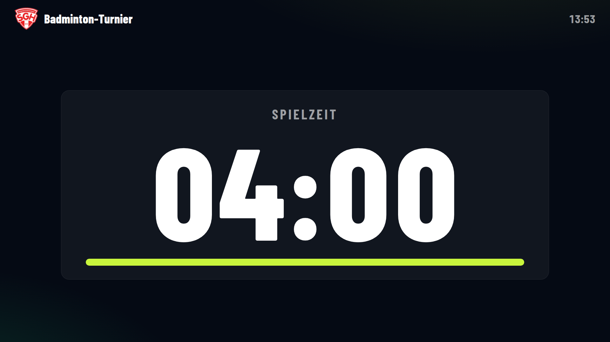 | 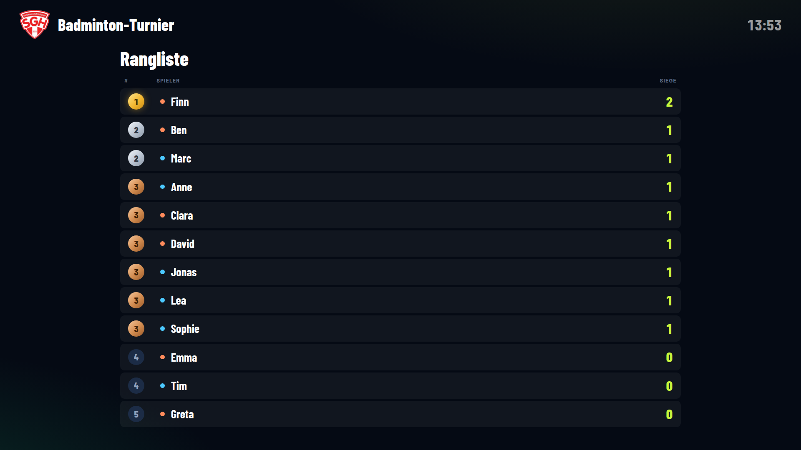 |

**Vor dem Start** zeigt der Beamer ein **Wartebild**. Im **Beamer-Setup** (Einrichtungsseite)
wählst du aus sechs Varianten (einfach oder verschiedene Animationen), schaltest das Vereinslogo
(aus: Federball), die „Gleich geht’s los …“-Kapsel und das Laufband mit Spielernamen ein oder
aus. Änderungen gelten sofort auch im geöffneten Beamer-Fenster.

Der Beamer zeigt außerdem die nächste Runde als „Als Nächstes“ und am Ende die Siegerehrung.

## 7. Musik und Spotify

**Musik** (Knopf oben oder Taste `M`) öffnet ein Fenster, das sich verschieben, zu einem
Mini-Player verkleinern und schließen lässt. Die Musik läuft dabei weiter.

### Lokale Musik

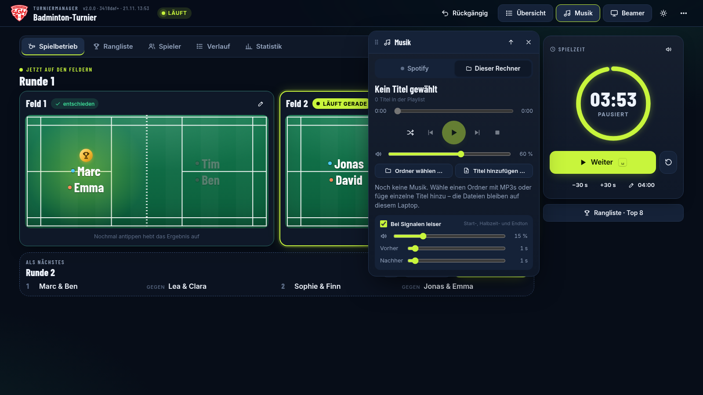

- **Ordner wählen …** oder einzelne Titel hinzufügen. Die Dateien bleiben auf dem Laptop.
- Abspielen, Pause, Stopp, vor/zurück, Zufallswiedergabe, Lautstärke, Suche in der Playlist,
  Titel entfernen, Playlist leeren.
- Nach dem Neuladen braucht ein Ordner einmal **Freigeben** (Browser-Sicherheit). Einzelne Titel
  sind sofort wieder da. Die Ordnerwahl gibt es in Chrome und Edge. In anderen Browsern gilt ein
  Ordner nur bis zum Schließen der Seite („temporär“).

### Automatisch leiser bei Signalen

Die lokale Musik wird bei jedem Signal (Start, Halbzeit, Ende, Testton) automatisch leiser und
danach wieder lauter. Einstellbar sind die Lautstärke während des Signals und die Sekunden leiser
**vor** und **nach** dem Signal. Beim Timerstart ist die Reihenfolge: erst leiser, dann Startton,
dann läuft die Zeit.

### Spotify

Zusätzlich gibt es einen Spotify-Player (Spotify Premium nötig, Internet nötig). Er spielt im
Browser oder auf einem aktiven Spotify-Connect-Gerät.

1. Im [Spotify Developer Dashboard](https://developer.spotify.com/dashboard) eine App anlegen.
2. In deren **Redirect URIs** die im Musikfenster angezeigte Adresse eintragen, exakt und mit
   abschließendem `/`.
3. Die **Client-ID** (kein Client-Secret) im Musikfenster einfügen und anmelden.

Neue Spotify-Apps laufen im Development Mode: höchstens fünf freigeschaltete Konten, der
App-Inhaber braucht Premium (Dashboard → Users Management). Spotify lässt sich aus
Browser-Sicherheitsgründen nicht bei Signalen automatisch leiser stellen, dafür die lokale Musik
verwenden. Alternativ setzt man beim Build `VITE_SPOTIFY_CLIENT_ID`.

## 8. Turnier beenden und Siegerehrung

- **Turnier beenden** (rechts in der Reiterzeile) fragt nach und wechselt zur Siegerehrung.
  Beim Schleifchenturnier passiert das automatisch nach der letzten Partie.
- Die Siegerehrung zeigt das **Treppchen** mit Platz 1, 2 und 3. Teilen sich mehrere einen Platz,
  stehen sie auf derselben Stufe. Dazu Konfetti. Auf dem Beamer gibt es zusätzlich Lichtstrahlen,
  Pokal, Glitzer und wachsende Stufen. Bei zwei Töpfen lässt sich zwischen **Gesamt** und den
  Töpfen umschalten.
- Unter dem Treppchen steht der **Endstand**.
- Knöpfe: **Nochmal Konfetti**, **Auf dem Beamer zeigen**, **Exportieren**, **Weiterspielen**
  (zurück zum Spielbetrieb) und **Neues Turnier**.

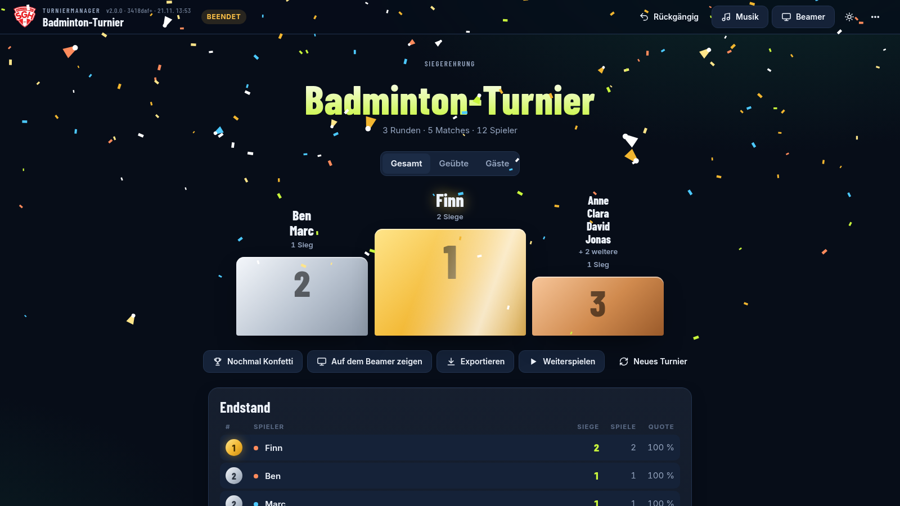

Und auf dem Beamer:

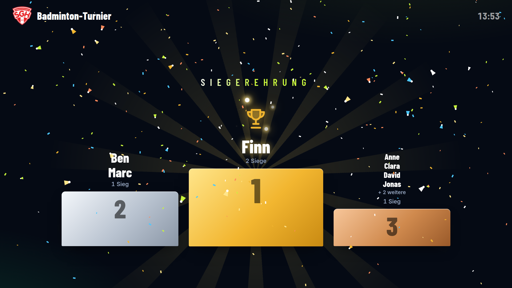

## 9. Export, Import, Neues Turnier

Im Menü oben rechts:

- **Turnier exportieren:** speichert den Stand als Datei (Sicherung oder Wechsel auf ein anderes
  Gerät).
- **Turnier importieren …:** lädt eine Exportdatei. Auch Exporte der alten Version werden
  umgewandelt. Der aktuelle Stand wird ersetzt, mit **Rückgängig** kommst du zurück.
- **Neues Turnier …:** beginnt von vorn (mit Rückfrage).
- **Rückgängig / Strg+Z** gilt für jede Änderung am Turnier.
- Die Kopfleiste hat außerdem einen Umschalter für **helles oder dunkles Design**.

## 10. Offline nutzen

- Die Seite **einmal mit Internet** öffnen, danach startet sie auch ohne Netz.
- **Chrome/Edge:** in der Adressleiste „Installieren“ klicken. **Safari (Mac):** Datei → Zum Dock
  hinzufügen. Firefox kann am PC nicht installieren, läuft aber auch offline.
- Timer, Turnier, Beamer und lokale MP3s laufen ohne Netz. Spotify braucht Internet.
- Daten liegen **pro Gerät und Browser**. Zwischen Geräten per Export/Import übertragen. Beim
  Löschen der Browserdaten geht auch der Offline-Cache verloren.
- Neue Versionen werden automatisch geholt, sobald das Gerät online ist (Versionsnummer in der
  Kopfzeile).
- Der Informationsknopf neben dem Titel fasst das zusammen.

## Tastenkürzel

**Steuerfenster**

| Taste | Aktion |
|---|---|
| `Leertaste` | Timer starten/pausieren |
| `Strg+Z` | Letzte Änderung rückgängig |
| `B` | Beamer öffnen |
| `M` | Musikfenster ein/aus |

**Beamer-Fenster**

| Taste | Aktion |
|---|---|
| `1` `2` `3` `4` | Übersicht, Felder, Timer, Rangliste |
| `F` | Vollbild |

## Fragen und Antworten

**Ein Spieler muss früher gehen oder ist verletzt.** Im Reiter *Spieler* pausieren. Er wird nicht
mehr ausgelost. Bereits ausgeloste, noch nicht gestartete Runden mit ihm lassen sich über
*Neu auslosen* oder in der *Übersicht* korrigieren.

**Jemand kommt später.** Im Reiter *Spieler* nachmelden. Er wird fair eingereiht.

**Ein Ergebnis war falsch.** In *Bereits gespielt* oder im *Verlauf* das andere Team antippen oder
die Punkte korrigieren. Die Rangliste rechnet sich neu.

**Ich habe ausversehen etwas geändert.** `Strg+Z`.

**Das Turnier ist zu früh zu Ende.** In der Siegerehrung **Weiterspielen** wählen.

**Der Beamer zeigt nichts Neues.** Beamer-Fenster und Steuerfenster müssen im selben Browser und
Profil laufen. Außerdem sollte das Turnier nur in einem Tab geöffnet sein.

**Kann ich mehrere Turniere parallel führen?** Nein, es gibt einen Stand pro Browser. Beende ein
Turnier mit Export und beginne ein neues.
